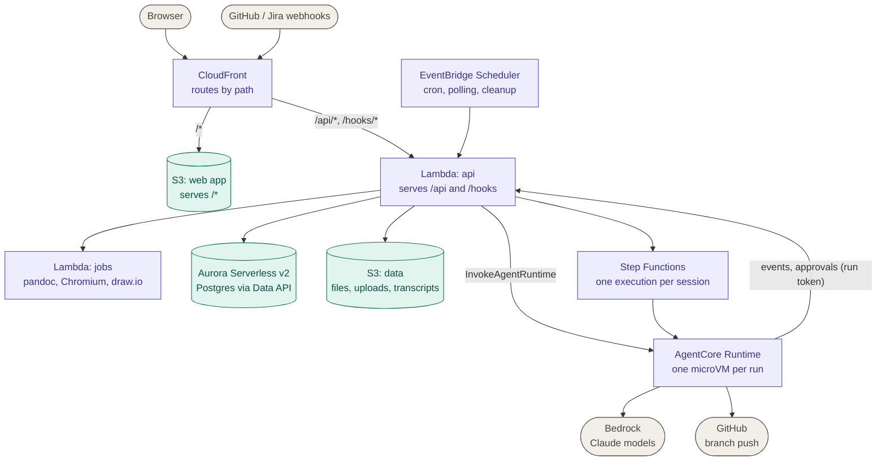
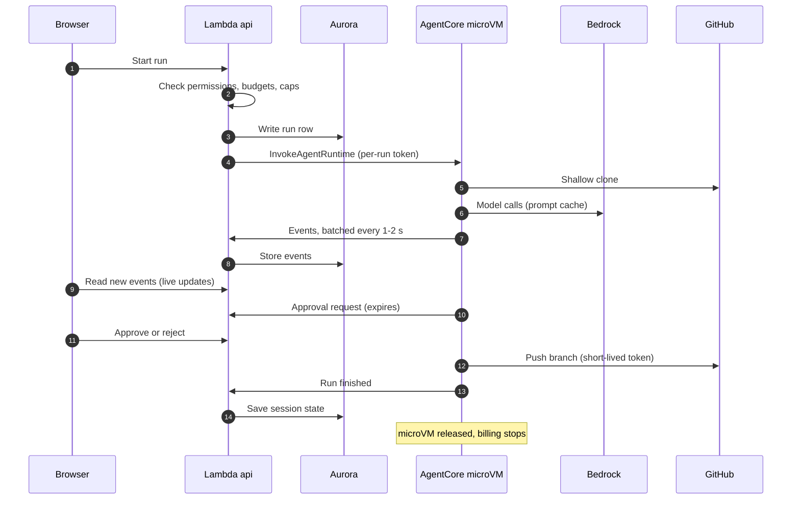
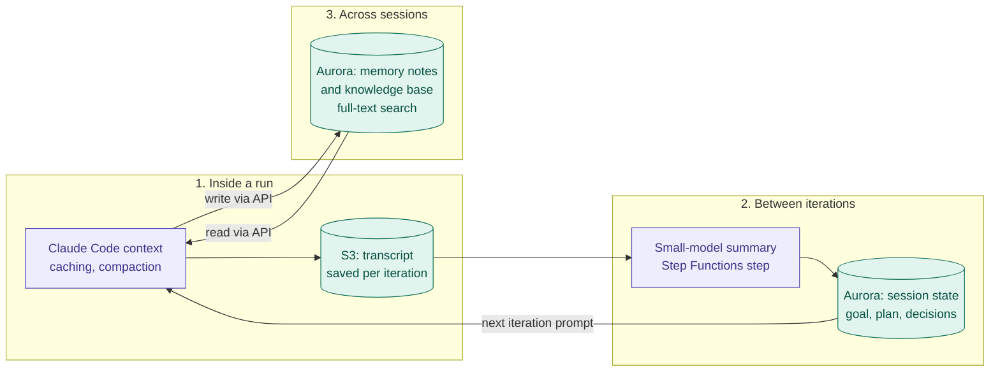

# Serverless migration plan v3: no EC2, cost controls first

Status: **draft for review** (2026-11-01). Replaces `docs/plans/2026-10-31-serverless-migration.md` (PR #10) and the interim v2 draft. Builds on branch `integration/all-prs` and on `reports/Cost efficient AWS hosting and pipeline.md` (the EC2 plan this replaces).

> All prices and effort figures are **estimates** from the v1 plan and general AWS pricing knowledge. Check them in the AWS Pricing Calculator and on the AgentCore pricing page before committing. Items marked **(verify)** are the ones most likely to be wrong.

## 1. What changed from v1 and v2

| Earlier plan | v3 | Reason |
|---|---|---|
| v1: full serverless, but live updates via SSE on Lambda reading the database | **Live-update design chosen by a spike** (SSE with cutoffs, long-polling, or a managed push service) | Lambda bills for the whole time a stream is open, and a database-backed stream keeps Aurora awake. |
| v1: WAF from day one (~$10 a month) | **Deferred** until the portal is public | 15-30% of the baseline. The API has its own auth. |
| v1: Secrets Manager + customer KMS key | **SSM Parameter Store SecureString, default key** | Free standard tier, no per-key fee. |
| v1: no token-cost levers | **Stage 0: token and budget controls** | Claude on Bedrock is usually the largest line, and the levers work on any hosting. |
| v1: agent runs sized by default | **Right-sized, capped, measured in a spike** | AgentCore bills memory while a run waits. |
| v2: one small EC2 instance hosts the portal in stage 1 | **No EC2 at any stage** | Requested: no always-on server charges. |
| v2: agents on AgentCore before the portal moves | **Agents move together with the API** | Without a server, the agent runner needs the Lambda API to call back to. It is built early and tested locally, and goes live at cutover. |

## 2. Goal

1. **No servers at all, including no EC2.** The web app comes from S3 through CloudFront, the API runs on Lambda, each agent run gets its own AgentCore microVM, and the data lives in scale-to-zero managed services.
2. Pay for what is used. A small team is idle most of the day.
3. Isolate agents from the portal's data and credentials.
4. Control the bill: caps, budgets and alerts exist before anything runs in the cloud.

## 3. Principles

1. **Measure before committing.** Two short spikes decide the expensive choices.
2. **Avoid fixed monthly fees:** no EC2, NAT gateway, VPC endpoints, ALB, WAF, OpenSearch or EFS until there is a reason.
3. **Every agent run has a cap** (tokens, minutes, memory) before it ships.
4. **Cost visibility from day one** (budgets, anomaly alerts, tags).
5. **Keep the portal usable throughout.** Until cutover the team keeps running the portal as it runs today (locally). Nothing new needs a cloud host before then, so there is no interim server to pay for.

## 4. What the server depends on today

Unchanged from v1 section 2:

- SQLite (52 tables, FTS5) and local disk in 42 modules.
- 14 modules that start child processes (git, Claude Code, Kiro CLI, pandoc, Chromium, draw.io).
- An in-process event bus with 3 SSE routes.
- Long-running loops (session driver, run queue) and timers (triggers, SLA, cleanup).
- 308 HTTP routes on one small router.

Each needs a serverless replacement, which is why this is a rewrite of the backend's foundations rather than a hosting change.

## 5. Stage 0: Cost guardrails and token levers (about 1 week, no migration)

Works on today's setup and keeps paying off afterwards.

- **Prompt caching** for Claude Code and session prompts.
- **Model tiering:** a small model (Haiku) for background and small calls, a mid model for normal work, the largest only when a project selects it. A per-project setting.
- **Batch inference** (about half price) for non-interactive work: scheduled triggers, Jira polling summaries, knowledge-base conversion summaries.
- **Hard caps** per run and per project: max tokens and max wall-clock minutes. Extends the budgets from PR #7.
- **AWS Budgets** with alerts, **Cost Anomaly Detection**, and cost-allocation tags per project.
- **Logging hygiene:** CloudWatch retention 14-30 days, no verbose event payloads in logs.

## 6. Spikes (about 1-2 weeks, in parallel with stage 0)

Each has a written pass/fail number. Results go into `docs/plans/` before the build starts.

| Spike | Question | Measure | Decision it drives |
|---|---|---|---|
| A. One agent run on AgentCore | Is AgentCore available in the chosen region, and what does a run cost? | Start-up time, cost per 30-minute run, smallest memory/vCPU that works, session storage limit, concurrent sessions, Kiro CLI behavior **(verify)** | Go/no-go, region, memory size |
| B. API on Lambda with live updates | What do SSE, long-polling and a managed push service cost for 5, 15 and 30 users? | GB-seconds per user per day, Aurora wake-ups, cold start, Aurora resume time | Live-update design |

For spike B, note that Lambda duration billing runs as long as a stream is open (about $5 per user per month for a 512 MB function open 8 hours a day on working days, about half at 256 MB arm64). Also check whether open streams stop Aurora from auto-pausing.

**Gate 0 (after the spikes):** proceed only if the measured cost per agent run and per user for live updates fit the estimates in section 11. If not, fix the design first (smaller memory, polling, managed push) or pause the migration.

## 7. Target architecture (no EC2)

#### Diagram 1: system overview

Purple is compute and orchestration, teal is storage, gray is external. There are no servers: no EC2, NAT, ALB or EFS.



#### Diagram 2: one agent run

The microVM can reach only Bedrock and GitHub. It has no access to portal data and talks to the API with a per-run token.



#### Component details

```
Browser
  | https://portal.example.com
  v
CloudFront
  |-- /*        -> S3: built React app (private, Origin Access Control)
  |-- /api/*    -> Lambda function URL (Origin Access Control, IAM auth)
  '-- /hooks/*  -> same Lambda (GitHub/Jira webhooks, HMAC checked)

Lambda "api"  (container image, existing router via AWS Lambda Web Adapter, arm64, 256 MB to start)
  |-- Aurora Serverless v2 PostgreSQL (min 0 ACU, auto-pause) via RDS Data API  -> no VPC, no NAT
  |-- S3 "data": documents, vault, generated outputs, uploads, config files
  |-- Step Functions: one execution per session
  |-- EventBridge Scheduler: cron triggers, Jira polling, cleanup, SLA checks
  '-- AgentCore Runtime: InvokeAgentRuntime, one microVM per run

AgentCore Runtime "agent-runner" (arm64)
  |-- Claude Code (Agent SDK) + git + the portal's guard and hooks
  |-- clones repositories into session storage, works, pushes a branch
  |-- Bedrock only, through its own execution role (no portal data access)
  '-- posts events, questions and approvals to the API with a per-run token

Lambda "jobs"  (container image, up to 15 min)
  '-- pandoc, Chromium, draw.io
```

### Choices

| Concern | Choice | Notes |
|---|---|---|
| Database | Aurora Serverless v2 PostgreSQL, minimum 0 ACU, via Data API | If the first-request delay (about 15 seconds) hurts, schedule a 0.5 ACU minimum for working hours only. Not DynamoDB (relational model), not OpenSearch (fixed cost), not SQLite on EFS (WAL does not work there, and EFS needs a VPC). |
| Full-text search | Postgres `tsvector` + GIN | Replaces FTS5. |
| API | Lambda via Lambda Web Adapter, arm64, 256 MB | Keeps `http.ts` and the route modules. No API Gateway. |
| Live updates | **Decided by spike B**: (a) SSE with a visible-tab and idle cutoff, (b) long-polling with backoff when no run is active, or (c) AppSync Events / API Gateway WebSockets | Completed runs are served from S3 or cache, not from Aurora. |
| Files | S3 behind a storage interface (S3 and local-disk versions) | Lifecycle rules expire run work folders and old uploads. |
| Agent runs | AgentCore Runtime, one microVM per run | Right-sized and capped (section 5). |
| Sessions | Step Functions Standard, task tokens for waits | Approvals and agent callbacks wait without cost. |
| Schedules | EventBridge Scheduler | |
| Secrets | SSM Parameter Store SecureString, default key | Secrets Manager only where automatic rotation is needed. |
| Edge protection | CloudFront with rate limiting; **WAF added later** when public | Check whether a CloudFront flat-rate / security bundle plan applies. |
| Backups | Aurora automated backups, S3 versioning on the data bucket | No Litestream or snapshots needed. |
| Context and memory | Transcripts in S3, session state and memory notes in Aurora, summaries by a small model | No vector database at first. See section 9. |

## 8. Flows

- **Starting an agent run.** The browser posts to `/api/...`. The `api` Lambda checks permissions, budgets and safety settings (PR #4), writes the run row, issues a per-run token and calls `InvokeAgentRuntime`. The container clones the repositories and runs Claude Code, with the guard and hooks (PRs #3-#6) enforced inside the microVM. Events are posted back **in batches every 1-2 seconds** (to cut Lambda invocations and database writes) and stored in `agent_run_events`. The browser reads new rows by `seq`.
- **Approvals and questions.** `canUseTool` posts the request with its fingerprint (PR #5) and waits by polling the API. **Requests expire** (PR #5) and the microVM is released, because AgentCore bills memory while a run waits for a person.
- **Sessions.** A Step Functions execution replaces `workflows/driver.ts`: compose the prompt, run an iteration, run the checks, then continue, finish, block, push or wait. Stop rules (PR #9), budgets (PR #7) and the push approval with the working-copy fingerprint (PR #5) move into the state machine and the API.
- **Checks outside the microVM.** Lint, tests and document conversion run in the `jobs` Lambda where possible, so the agent microVM is billed only for agent work.
- **Pushing.** The container pushes the session branch with a short-lived, repository-scoped token issued for that run, only after the portal allows it. Shallow clones; repository bundles cached in S3 for large repositories.
- **Documents and diagrams.** pandoc, Chromium and draw.io run in `jobs`. Anything over 15 minutes runs as an AgentCore command.
- **Knowledge base.** Uploads go to S3, conversion runs in `jobs`, Markdown and the search index go into Postgres.
- **Triggers.** EventBridge Scheduler for cron, Jira polling and cleanup. Webhooks go through CloudFront to the API.

## 9. Context and memory management

Agents need to keep context small (it drives token cost) and still remember what matters. Three layers, from the shortest-lived to the longest-lived. All of them use services already in this plan: no vector database or extra fixed-fee service is added.



### 9.1 Inside one run (working context)

- **Claude Code compacts its own context.** Rely on that, and enforce the per-run token cap from stage 0.
- **Keep the prompt prefix stable** (system prompt, project instructions, tool definitions) so prompt caching hits. The cache expires after a few minutes, so a run that waits longer than that for a human approval pays full price on resume. This is another reason to keep approval expiry short.
- **The microVM is disposable.** At the end of each iteration the runner saves the session transcript and working state to S3, so a run can resume in a fresh microVM instead of replaying everything.

### 9.2 Between iterations in a session

- **Do not carry the full transcript forward.** At the end of each iteration the Step Functions loop writes a compact **session state** to Aurora: goal, plan, decisions made, files changed, check results, open questions.
- **Each new iteration's prompt is composed from that state:** project instructions, the session state and the next task.
- **The summary is produced by a small, cheap model** (Haiku) as a step in the state machine.
- **`agent_run_events` is the audit log, not memory.** Events older than N days are archived to S3 (compressed) to keep Aurora small.

### 9.3 Across sessions and projects (long-term memory)

- **Start with what the plan already has:** knowledge-base documents plus Postgres full-text search (`tsvector`), extended with per-project and per-user **memory notes** stored as rows in Aurora. The agent reads and writes notes through the API with its run token, never directly against the database.
- **No vector database at first.** OpenSearch Serverless has a high monthly minimum, which this plan avoids. If keyword search proves too weak, test pgvector in Aurora or S3 Vectors with a Bedrock Knowledge Base. How they work with the RDS Data API, and their cost, are not yet checked **(verify)**.
- **AgentCore Memory is an option, not the default.** It adds per-event and per-record charges on top of what is already stored. Adopt it only if the portal's own memory tables become a maintenance burden **(verify pricing)**.

### 9.4 Rules for all three layers

- **Scope memory by tenant, project and user.** Isolation is the main reason for AgentCore, so memory must not leak across projects.
- **Treat memory content as data, not instructions.** Stored notes can carry prompt injection, so the guard and approval checks still apply to anything the agent does after reading them.
- **Set size limits and expiry** on notes and summaries, so prompts do not grow without bound.
- **Measure.** Track tokens per iteration and cache hit rate, so a growing prompt shows up on the cost dashboard before it shows up on the bill.

## 10. Phases

Order matters because there is no interim server: the Lambda API and the database must exist before agents on AgentCore can call back to them. The agent runner is built early and tested against a **local** portal, then goes live at cutover.

| Phase | What | Effort (one engineer) |
|---|---|---|
| **S0 Foundations** | Async data layer (the `one/all/run/insert/update` helpers become `async`; every caller converted). Database adapter with SQLite and Postgres versions; the test suite runs against both. Storage interface (local disk / S3). Event-source interface (in-memory / database-backed). All still running locally. | 3-4 weeks |
| **S1 Agent runner** (parallel with S0 and S2 if two engineers) | `agent-runner` container image. Runner API for events, questions, approvals and the run token. Guard and hooks inside the container. Clone and push in the session. AgentCore execution role (Bedrock only). `agentcore` engine beside the SDK, Kiro and demo engines, chosen per project. Caps from stage 0 enforced. Save and restore the session transcript to S3 per iteration (section 9.1). Tested against the local portal. | 3-4 weeks |
| **S2 Data to Aurora and S3** | Postgres schema from the 52 tables. FTS5 replaced by `tsvector`. Tables for session state and memory notes, scoped by tenant, project and user (sections 9.2-9.3). One-time migration of data and files. Key file replaced by SSM. | 2-3 weeks |
| **S3 API on Lambda, app on S3** | Lambda Web Adapter image, function URL with Origin Access Control, SPA to S3, CloudFront behaviors, live updates per spike B, webhooks. A **staging stack** goes up here for the team to try. | 2 weeks |
| **S4 Orchestration and jobs** | Step Functions session state machine. Run queue and concurrency caps as database rows. EventBridge Scheduler for triggers and cleanup. `jobs` Lambda. Session-state summary step (small model) and event archiving to S3 (sections 9.2). | 3-4 weeks |
| **S5 Pipeline and cutover** | AWS CDK stack (TypeScript). GitHub Actions with OIDC deploys the images, the SPA and the stack. Rehearse the data migration. Cut over. Remove the old run path from the docs. | 1-2 weeks |

**Total: about 14-19 weeks for one engineer, about 10-13 weeks with two** (S1 in parallel with S0 and S2).

**Trade-off to be aware of:** with no server in between, the benefits (agent isolation, pay per run, no patching) arrive at cutover rather than early. The staging stack at S3 lets people use the cloud version before then.

**Gate 1 (after S3 staging has run for 1-2 weeks):** compare measured cost per user and per run with section 11. Cut over only if it fits. Otherwise adjust the live-update design or memory sizes first.

## 11. Cost estimate (Singapore, 5-30 people, light use) **(verify)**

Excluding Claude tokens, which are usage-based and usually the largest line.

| Item | Monthly |
|---|---|
| Aurora Serverless v2 (auto-pause) plus storage | about $15-40 |
| Lambda (api + jobs) | about $3-15 (depends on the live-update design) |
| Step Functions, EventBridge Scheduler | about $1-2 |
| S3 (app, data, repo bundles) | about $1-3 |
| CloudFront | about $0-1 |
| WAF | $0 now, about $10 later |
| SSM, logs, alarms, Budgets | about $2-4 |
| **Subtotal (no servers)** | **about $25-65** |
| AgentCore Runtime | about $15-45 (v1 estimate: about $30 at 20 runs a day; right-sizing and idle caps lower it) **(verify the rates)** |
| Claude on Bedrock | usage-based; caching, tiering, batch and compact session state (section 9) reduce it |
| Memory (session state, notes, archived events) | negligible: a few extra Aurora and S3 GB, plus small-model summary calls |

There is no EC2, NAT, ALB or EFS charge. Cost depends mainly on usage, so it is lowest when the team is idle and rises with agent runs and open live-update connections.

## 12. Risks and open questions

| Risk | Effect | Mitigation |
|---|---|---|
| AgentCore not available in Singapore | Agents in another region | Check in spike A; keep data in Singapore, run agents nearby; check cross-region transfer cost |
| SSE on Lambda costs more than expected | Bill higher than estimate | Spike B; visible-tab cutoff; polling or managed push |
| Open tabs keep Aurora awake | Scale-to-zero never happens | Idle cutoff; no polling when no run is active |
| Aurora resume from zero (about 15 seconds) | Slow first request | Working-hours minimum of 0.5 ACU; warm on sign-in |
| RDS Data API limits (response size, time) | Large exports fail | Paginate; heavy reports in `jobs` |
| Async data layer touches most of the server | Largest, riskiest step | Done first (S0), mechanically, ~1,000 existing tests on both databases |
| No cloud benefit until cutover | Long wait for isolation | Staging stack at S3; build S1 early so it is ready |
| AgentCore memory billed during waits | Forgotten approvals cost money | Approval expiry, idle timeout, wall-clock cap |
| Kiro CLI uses a local sign-in | May not work in AgentCore | Keep Kiro on a legacy path (run locally), or use an API key in the container **(verify)** |
| Git-heavy work in each microVM | Slower, more transfer | Shallow clones, repository bundles in S3 |
| SSE connection over 15 minutes cut | Reconnects | Browser already reconnects with sequence replay; tested |
| More AWS services to understand | Harder to debug | CDK in the repo, structured logs, one dashboard |
| Session summaries lose important detail | Agent repeats or contradicts earlier work | Structured state fields (decisions, open questions), keep the last iteration's key outputs verbatim, review a sample of summaries |
| Memory notes carry prompt injection or leak across projects | Unsafe agent actions or data exposure | Scope by tenant, project and user; access only through the API; treat notes as data; guard and approvals still apply |
| Keyword search is too weak for long-term memory | Poor recall | Measure first; then test pgvector or S3 Vectors **(verify)** |

## 13. Decisions needed from the owner

1. Approve a no-EC2 plan with the later-arriving benefits (section 10), or keep a small server for an early hybrid step.
2. Region: Singapore for everything, or agents in another region (depends on spike A).
3. Whether the Kiro engine must work on the serverless path.
4. Infrastructure as code: AWS CDK in TypeScript (recommended) or Terraform.
5. Domain name for CloudFront, or the default `*.cloudfront.net` at first.
6. Default model tier per project and default per-run caps (tokens, minutes).
7. Long-term memory: start with Aurora tables and full-text search (recommended), or adopt AgentCore Memory or a vector option from the start.

## 14. Next steps

1. Review this plan; decide item 1 above.
2. Stage 0: Budgets, anomaly detection, tags, prompt caching, model tiering, run caps.
3. Spike A (AgentCore, about 1 week) and spike B (Lambda live updates, a few days). Write the results into `docs/plans/`; pass gate 0.
4. Start S0, and S1 in parallel if a second engineer is available.
5. Draft the session-state and memory-note schema (section 9) with the S2 Postgres schema.
